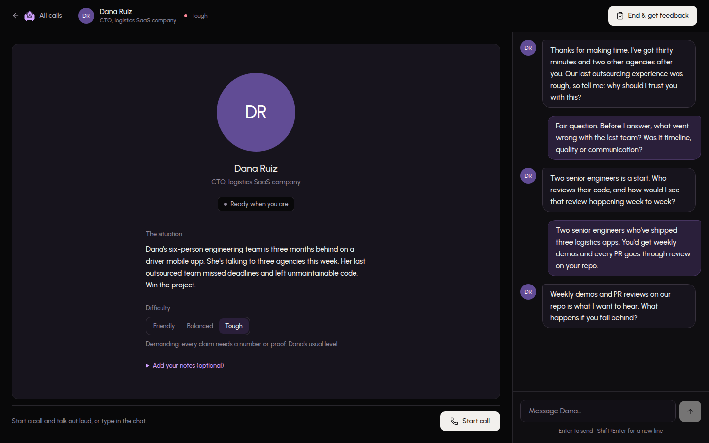

<div align="center">


# Hotseat

**Get grilled before it counts. Practice investor pitches and client calls out loud against AI personas who push back, then get a scorecard.**

[](https://github.com/voirlabs/hotseat/actions/workflows/ci.yml)
[](LICENSE)



</div>

## What it does

- Live voice calls, speech to speech over OpenAI Realtime. The persona answers in its own voice about a second after you finish, waits while you pause to think, and stops as soon as you talk over it. You can also type mid-call; the chat and the call share one conversation.
- Paste your deck text, one-pager or key numbers before a call. The persona asks about them, and the scorecard checks you used them consistently. Notes stay in your browser and travel with each request; the server never stores them.
- Each persona has a brief you read before the call, the topics they always push on and the things that make them walk away. Each also has a difficulty (friendly, balanced or tough), and you can pick another for any call.
- Two kinds of call: pitch investors (seed VC, operator angel, growth partner) or win clients (skeptical CTO, first-time founder, procurement lead).
- When you hang up you get a scorecard: an overall score, six scored areas, what landed, what to fix and the toughest question to prepare for. It also shows how you sounded: your share of the talking, speaking pace, filler words, longest answer and questions asked. You can download the session as Markdown.
- Each scorecard shows the change since your last call with that persona, and the home page lists your recent calls. History stays in your browser and you can clear it at any time.
- One owner per deployment, who signs in with `ADMIN_PASSWORD`. The app needs one OpenAI key, which never reaches the browser. A new persona is one JSON file.

## How it works

```
Browser                                   Server (Next.js route handlers)
───────                                   ───────────────────────────────
SDP offer, persona, notes ▶ /api/realtime   opens a Realtime session: key, model, voice, persona prompt
mic ◀──WebRTC audio, both ways──▶ OpenAI Realtime (speech to speech)
    ◀─data channel: transcripts of both sides, turn events
typed message (no call) ▶ /api/chat       persona prompt + recent history → LLM, streams text
conversation ──────────▶ /api/feedback    transcript → scorecard (strict JSON schema, Zod-validated)
```

A call costs more than a chat: audio in and out on the Realtime API. `CALL_MAX_MINUTES`
caps each call (the server hangs up through OpenAI's API, not just the browser), at most
two calls run at once, and the cheaper `gpt-realtime-2.1-mini` is the default.

Every API route goes through one guard (`lib/server/api.ts`): same-origin check, session
check (the owner's sign-in), per-client rate limit and Zod validation. The browser sends a
persona id and the conversation; it never chooses the model, voice or system prompt.

## Quickstart

Requires Node.js 24 and [pnpm](https://pnpm.io) 10.

```bash
git clone https://github.com/voirlabs/hotseat.git
cd hotseat
pnpm install
cp .env.example .env.local   # set OPENAI_API_KEY and ADMIN_PASSWORD (openssl rand -base64 18)
pnpm dev
```

Open http://localhost:3000, sign in with your `ADMIN_PASSWORD`, pick a call and start talking. Voice needs a microphone and a
secure context (localhost counts). Without a key the app runs and tells you what to set.

## Configuration

All configuration is through environment variables. See [`.env.example`](.env.example).

| Variable | Default | Purpose |
|---|---|---|
| `OPENAI_API_KEY` | | Required. Powers voice calls, chat and the scorecard |
| `OPENAI_MODEL` | `gpt-5.4-mini` | Chat model for typed replies and the scorecard |
| `OPENAI_BASE_URL` | `https://api.openai.com/v1` | Chat completions endpoint, e.g. a local Ollama. Voice calls always use OpenAI |
| `OPENAI_REALTIME_MODEL` | `gpt-realtime-2.1-mini` | Speech-to-speech model for voice calls. `gpt-realtime-2.1` is sharper and costs more |
| `OPENAI_TRANSCRIBE_MODEL` | `gpt-4o-transcribe` | Transcribes your side of a call for the chat and the scorecard |
| `TRANSCRIBE_LANGUAGE` | auto-detect | Two-letter language code for call transcription, e.g. `en` or `de`. Personas reply in the language you speak |
| `CALL_MAX_MINUTES` | `20` | The server hangs a voice call up after this many minutes, to bound its cost. At most 2 calls run at once |
| `ADMIN_PASSWORD` | | Required, at least 12 characters (`openssl rand -base64 18`). The owner signs in with it; every page and API route needs the session. Without it nothing opens |
| `SESSION_SECRET` | derived from `ADMIN_PASSWORD` | Recommended. Random key of at least 32 characters (`openssl rand -base64 32`) that signs session cookies. Changing it signs every session out |
| `RATE_LIMIT_PER_MINUTE` | `30` | Requests per minute per client for chat and feedback. Starting calls has a lower limit; sign-in counts failed attempts separately |
| `TRUSTED_PROXY_HOPS` | `1` on Vercel, Render, Railway, Fly.io and Heroku, else `0` | Reverse proxies whose `X-Forwarded-For` you trust. With `0`, signed-in users get a limit per session and everyone else shares one |
| `NEXT_PUBLIC_APP_URL` | `http://localhost:3000` | Public URL of this deployment, used in Open Graph metadata. When it's https, the session cookie is always `Secure` |

## Deploy

Any Node.js host works: `pnpm build && pnpm start`. On Vercel, Render, Railway, Fly.io and
Heroku each client gets its own rate limit out of the box. Behind your own reverse proxy
(nginx, Caddy, a load balancer), set `TRUSTED_PROXY_HOPS` to the number of proxies in front
of the app. Don't set it higher than that: the app would then trust addresses the client
made up.

Every deployment is private to its owner (`ADMIN_PASSWORD`), so strangers can't spend your
OpenAI credits. Set a spend limit on your OpenAI account anyway.

Limits live in the server's memory: rate limits, failed sign-ins, the two-call cap and the
timer that hangs up a call after `CALL_MAX_MINUTES`. A long-running server (`pnpm start`, a
container, a VM) enforces all of them. On serverless platforms each instance counts on its
own and may be frozen once a response is sent, so a timer can't outlive the request: there
the call limit is best effort (the browser still ends the call, and OpenAI's own session
limit is the backstop) and rate limits are a speed bump.

Sign-in: wrong passwords count against the client (10 per 15 minutes) and against a global
budget (50 per hour); past it, only one attempt is allowed per backoff period, up to a
minute, so you can still get in while guessing stays slow. Sessions are signed cookies, valid
for 7 days. Signing out deletes the cookie in your browser; to revoke every session at once,
change `SESSION_SECRET` (or the password). Deployments without `SESSION_SECRET` keep working,
with the signing key derived from the password; anyone signed in before this change signs in
once more.

Serve the app over https. Hotseat sends `Strict-Transport-Security` when it sees https
(directly or through `X-Forwarded-Proto`); if your proxy terminates TLS without passing that
header, set HSTS at the proxy.

The landing page in [`site/`](site) is a separate static site on Firebase Hosting; see [site/README.md](site/README.md).

## Development

```bash
pnpm dev     # start the dev server
pnpm check   # lint + typecheck + tests
pnpm build   # production build
```

Stack: Next.js 16 (App Router), React 19, TypeScript, Tailwind CSS 4, Zod, Vitest.

### Adding a persona

To add a persona, create `personas/<id>.json` (the file name must match the `id`), import
it in `lib/personas/index.ts` and run `pnpm test`, which fails if the file is invalid or not
registered. `scenario` picks the framing and the scorecard categories from
`lib/scenarios.ts`. `voice.openai` is one of the Realtime voices (`alloy`, `ash`,
`ballad`, `cedar`, `coral`, `echo`, `marin`, `sage`, `shimmer`, `verse`), and
`voice.instructions` says how the persona sounds on a call. Personas must be fictional; pull requests that imitate real people or clone
real voices won't be merged.

```json
{
  "id": "your-persona",
  "name": "Casey Rivera",
  "title": "COO, regional clinic group",
  "scenario": "client",
  "tagline": "One line shown on the card.",
  "brief": "The situation, shown before the call: who they are, what they need, what you're trying to achieve.",
  "difficulty": "balanced",
  "opener": "First thing they say when the meeting starts.",
  "style": "Temperament, habits and how they speak.",
  "probesFor": ["Topics they always push on"],
  "dealBreakers": ["Things that make them pass"],
  "avatar": { "initials": "CR", "from": "#a77fe0", "to": "#3b2363" },
  "voice": { "openai": "sage", "instructions": "How the voice should sound." }
}
```

## Contributing and security

Issues and pull requests are welcome; new personas are the easiest way to start. Read
[CONTRIBUTING.md](CONTRIBUTING.md) and the [Code of Conduct](CODE_OF_CONDUCT.md). Report
vulnerabilities privately as described in [SECURITY.md](SECURITY.md).

## License

[MIT](LICENSE) © Voir Labs LLC. Hotseat is by [Voir Labs](https://www.voirlabs.io/).

The Hotseat and Voir Labs logos and the artwork in `site/assets/` are not covered by the license.

All personas are fictional and any resemblance to real people is coincidental. Feedback is
generated by AI and isn't investment, sales or legal advice.
